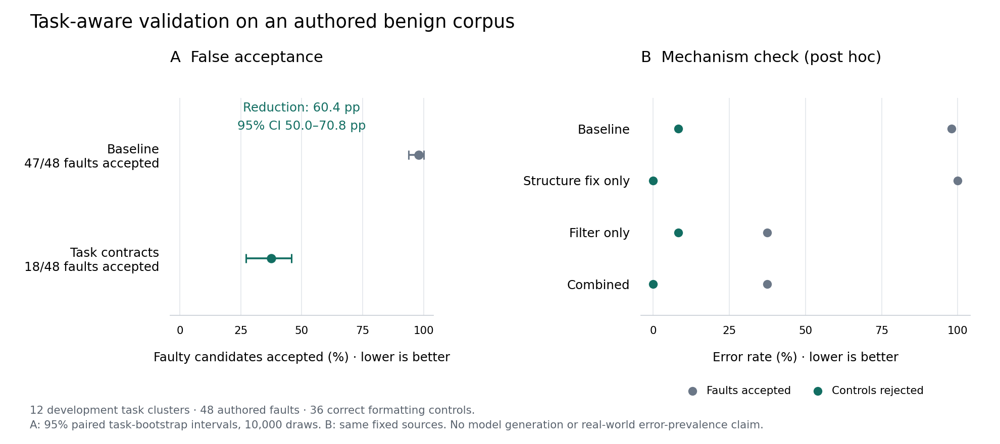

# Controlled benign fault audit

False acceptance fell from 47/48 to 18/48 on fixed authored faults; this is validator sensitivity, not a model-generation result.

The paired reduction is 60.4 percentage points (95% task-bootstrap interval 50.0–70.8; 12 task clusters).

Correct-control false rejections fell from 3/36 to 0/36. All three affected variants use the same Python accumulator pattern.

All 18 remaining false acceptances expose incomplete specifications: 14 unseen-input/memorization faults, three internally consistent documents with altered inputs, and one incorrect HTML calculation.

The mechanism check separates the gains: the accumulator fix recovers correct controls; task contracts reject semantic faults. Filtering alone does not recover the controls rejected by the original structure check.

## Results

| System | Faults accepted | Correct controls rejected |
| --- | ---: | ---: |
| baseline | 47/48 | 3/36 |
| contract | 18/48 | 0/36 |

[PDF figure](figure.pdf) · [SVG figure](figure.svg)

## Post hoc mechanism check

| System | Faults accepted | Correct controls rejected |
| --- | ---: | ---: |
| baseline | 47/48 | 3/36 |
| structure-fix | 48/48 | 0/36 |
| filter-only | 18/48 | 3/36 |
| contract | 18/48 | 0/36 |

## Methodology

### Fixed corpus

Twelve development tasks across seven formats and three authored complexity levels. Each has three correct whitespace/serialization variants and four deterministic faults: 84 unique sources, evaluated by both systems. No model was called; no held-out task was used.

### Fault construction

Numeric API rename, one public-trigger error, one private-trigger error, and public-example memorization. Documents use schema/reference/count/label/calculation mutations. Private fixtures deliberately construct difficult omissions; this is not a natural-error distribution.

### Comparison and truth

The baseline is the original parser/compiler/functional checker. The enhanced system adds public contracts and the accumulator-dependency fix. Every correct/fault label was confirmed against native Python/LLVM, read-only SQLite, or independent exact-document outcomes. Both systems saw identical source bytes.

### Denominators

False acceptance divides accepted faulty candidates by 48 faulty candidates. False rejection divides rejected correct candidates by 36 correct variants. The 168 validations are 84 paired sources, grouped in 12 tasks, not 168 independent samples. Public examples intentionally leave some faults detectable only by the independent grader.

### Uncertainty

A paired percentile bootstrap resamples the 12 tasks 10,000 times, retaining all four faulty variants and both systems within each task. The interval describes sensitivity on this authored development corpus; it is not a population guarantee. The protocol specified this analysis before validation; no external preregistration is claimed.

### Reproduce

The downloadable archive contains both frozen source trees, the runner, corpus, contracts, oracles, protocol hashes, and raw checks. On macOS with the repo dependencies and Clang, extract to a new directory and run the driver: python runner/reproduce.py . (the final dot names the extracted directory). It verifies hashes, re-runs primary and ablation checks in separate temporary copies, compares outcomes, and preserves the original evidence. Transient timings and compiler paths are excluded from outcome comparison.

### Post hoc mechanism check

A separately frozen addendum evaluates the enhanced engine without contracts on all 84 original sources, then derives baseline-plus-contract filtering from recorded checks. Structure-only accepts 48/48 faulty sources and rejects 0/36 correct controls; filter-only accepts 18/48 faults and rejects 3/36 controls. The combined system accepts 18/48 faults and rejects 0/36 controls. This separates the control-recovery fix from semantic rejection without adding tasks or measuring generation quality. The reproduction archive includes this addendum and a driver that re-runs it without overwriting its frozen inputs.

### Reproduction verification

All 168 primary decisions and independent grades, 84 additional structure-only validations, and 84 derived filtering decisions reproduced exactly in isolated copies. Original evidence remained unchanged. Runtime versions are included in the machine-readable report.

## Limitations

- Faults were deliberately authored to exercise known contract mechanisms and omissions; this is not an estimate of real model error frequency.
- Only 12 development task clusters and 36 formatting controls. Formatting variants do not add semantic diversity.
- The baseline does not consume task requirements; this measures the value of providing/enforcing those requirements, not a universal code verifier.
- Public examples can be memorized and can miss unseen-input faults. Passing a contract is not a proof of correctness.
- Exact-document grading and native grading share parser/eligibility dependencies with production checks.
- No new GLM/DeepSeek generation, assembled-binary retention, deployment, or traffic-replay outcome is measured.

## Integrity

{
  "protocol_sha256": "2da61f359ea0f3a44b90adc6f54d47e1b90eb4bab6dc7aff5ba76c95071363da",
  "baseline_commit": "65d5cb357140d2c76808f254c7d2a4b6d95f3f31",
  "snapshot_files": 133,
  "reproduction_sha256": "1a858d4e38839efa9c1a425199d2c34734083980a34847cae724b6f0ba9b62b8",
  "scores_sha256": "e9b29bcf70aaa98dec3fa0f48f92a2b4848c7f02bcb175158fa029b6ee49763c"
}
